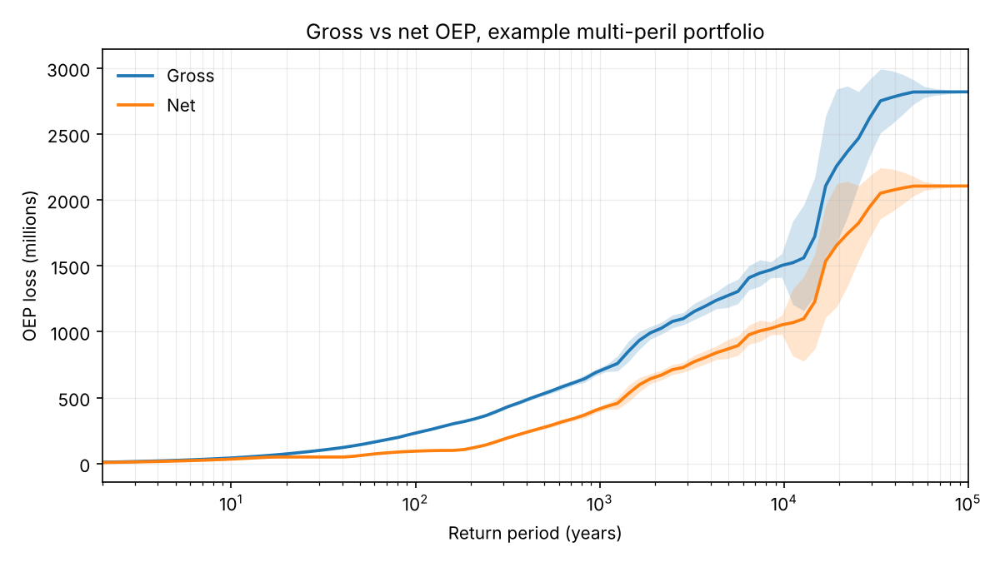

# catagg

**Catastrophe loss aggregation, from event loss tables to net exceedance probability curves.**

[](https://github.com/John-Amal/catagg/actions)
[](https://pypi.org/project/catagg/)
[](https://john-amal.github.io/catagg/)
[](LICENSE)

---

## The question this answers

A reinsurer holds a portfolio exposed to several perils. The catastrophe models produce an **event loss table** — for each modelled event, an annual rate and a loss distribution. Two questions follow immediately, and every pricing, capital and reinsurance-purchase decision depends on them:

**How much loss should we expect in a bad year, and how much of it do we actually keep after our reinsurance programme responds?**

`catagg` answers both. It simulates the year loss table, builds the gross exceedance probability curves, applies the reinsurance structures in the correct order, and returns gross, ceded and net views — with the validation checks that show the answer can be trusted.



*Example portfolio: three perils, 20% quota share, a 50m xs 50m per-occurrence layer with two reinstatements, and a 100m aggregate stop-loss. The programme removes roughly two thirds of the 200-year occurrence loss — and the reinstatement cap is visible as the point where the net curve stops flattening.*

---

## Install

```bash
pip install catagg
```

Python 3.11+. Runtime dependencies are numpy, pandas, pyarrow and scipy — nothing else.

---

## Quickstart

```python
import catagg as ca

# 1. Load an event loss table
elt = ca.read_elt("portfolio.parquet")

# 2. Simulate 100,000 years
yelt = ca.simulate(
    elt,
    n_years=100_000,
    frequency="negative_binomial",   # or "poisson"
    secondary_uncertainty=True,
    seed=42,
)

# 3. Gross view
gross = ca.ep_curve(yelt)
print(gross.at_return_period([10, 50, 100, 200, 250]))

# 4. Apply a reinsurance programme
programme = ca.Programme([
    ca.QuotaShare(cession=0.20),
    ca.ExcessOfLoss(attachment=50e6, limit=50e6, reinstatements=2, basis="occurrence"),
    ca.AggregateStopLoss(attachment=100e6, limit=100e6),
])

result = programme.apply(yelt)
net = ca.ep_curve(result.net)

# 5. Compare
ca.plot.ep_comparison({"Gross": gross, "Net": net}, kind="OEP")
```

Everything runs from a clean clone — the example portfolio is generated synthetically by a documented generator, so there are no data dependencies and no licensing questions.

---

## Concepts

If you already work in cat modelling, skip this. If you're reading the code to learn, this is the map.

| Object | What it is |
|---|---|
| **ELT** | Event loss table. One row per modelled event: annual rate λ, mean loss, standard deviation, exposed value. |
| **YELT** | Year event loss table. One row per event *occurrence* per simulated year. The engine's central output. |
| **YLT** | Year loss table. One row per simulated year: aggregate loss and maximum occurrence loss. |
| **OEP** | Occurrence exceedance probability. The distribution of the *largest single event* in a year. Drives per-occurrence cover. |
| **AEP** | Aggregate exceedance probability. The distribution of *total annual* loss. Drives aggregate cover and capital. |
| **AAL** | Average annual loss. The mean of the AEP distribution, and the cleanest check on the whole pipeline. |
| **TVaR** | Tail value at risk. The mean loss given exceedance of a return period. What capital regimes actually ask for. |

---

## What's in the engine

**Frequency.** Poisson, or negative binomial where event clustering matters — European windstorm and hurricane seasons are both over-dispersed, and a Poisson assumption understates the aggregate tail.

**Secondary uncertainty.** Loss given occurrence is sampled from a beta distribution on `[0, exposed_value]`, fitted by moments to the ELT's mean and standard deviation, with probability mass at zero and at full exposure. Degenerate cases — zero variance, or a variance the beta support cannot accommodate — are handled explicitly rather than silently clipped.

**Dependence.** Perils are correlated through a Gaussian or Student-t copula applied to annual losses. Independence is the default; the example shows what assuming it costs you in the tail.

**Financial structures.** Applied in programme order:

- Quota share, with optional ceding commission
- Per-occurrence excess of loss: attachment, limit, *n* reinstatements at stated percentages, pro-rata to amount, with the aggregate cap of `limit × (1 + n)` enforced
- Aggregate excess of loss and stop-loss
- Franchise deductible

**Metrics.** OEP, AEP, AAL, TVaR at any return period, full return-period tables, and Monte Carlo standard errors on every tail statistic.

---

## Validation

Numerical libraries in this domain live or die on whether you can show they're right. `catagg` ships a validation suite that runs in CI and as a readable notebook:

- Simulated AAL converges to the analytic `Σ λᵢ · μᵢ`
- Sampled frequency moments match the specified Poisson or negative binomial
- Sampled severity recovers the input mean and standard deviation
- Ceded loss never exceeds the aggregate reinstatement cap
- Net + ceded = gross, exactly, in every simulated year
- Tail-metric standard error as a function of simulation count

That last one matters more than it looks. A 200-year return period estimated from 10,000 simulation years carries a standard error large enough to change decisions, and most workflows never report it. `catagg` reports it by default.

See [docs/validation](https://john-amal.github.io/catagg/validation/).

---

## Scope

**In scope:** everything above.

**Deliberately out of scope for v0.1:** hazard modelling, vulnerability curves, location-level financial terms, exposure data management, a graphical interface, cloud orchestration.

`catagg` starts where the cat model stops. If you need the full modelling stack, use [Oasis LMF](https://oasislmf.org/). If you need to understand, audit or prototype the aggregation and financial layer, use this.

---

## Roadmap

- **v0.2** — location and policy-level terms, surplus share, reinstatement premium calculation
- **v0.3** — OED-compatible ELT ingest, `oasislmf` interoperability
- **v0.4** — event-level correlation across sub-perils, seasonality in event timing

Issues and pull requests are welcome, particularly from anyone who has implemented reinstatement logic in production and disagrees with this one.

---

## Citing

If you use `catagg` in published work, cite the Zenodo record: *(DOI added on first release.)*

## Licence

MIT.
